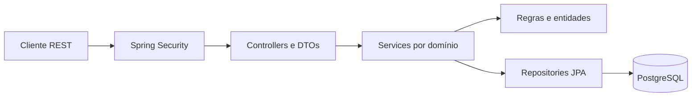

# OrderSphere

Auditoria atual da fundação / Current foundation audit: [resultados e prontidão / results and readiness](docs/backend-foundation-final-audit.md).

Licença: [MIT](LICENSE) — Copyright (c) 2026 Guilherme Novais.
License: [MIT](LICENSE) — Copyright (c) 2026 Guilherme Novais.

[](https://github.com/GuiNovaisz/ordersphere-java-commerce/actions/workflows/ci.yml)

> 🇧🇷 **Documentação em Português (Brasil)**
>
> 🇺🇸 **The complete English version is available immediately after the Portuguese section.**

Backend de catálogo, estoque e pedidos com consistência transacional. **v0.1.1 — Backend Foundation Consolidated:** 22 testes aprovados e execução Docker verificada. Consulte a [auditoria](docs/audit.md) e o [relatório de implementação](docs/implementation-report.md). [Release v0.1.1](https://github.com/GuiNovaisz/ordersphere-java-commerce/releases/tag/v0.1.1).

## Sumário

| Português | English |
| --- | --- |
| [Visão geral](#visao-geral) | [Overview](#overview) |
| [Por que este projeto existe](#objetivo) | [Purpose](#purpose) |
| [Funcionalidades e domínios](#funcionalidades) | [Features and domains](#features) |
| [Stack](#stack-pt) | [Tech stack](#tech-stack) |
| [Arquitetura e modelagem](#arquitetura) | [Architecture and data model](#architecture) |
| [Concorrência](#concorrencia) | [Concurrency](#concurrency) |
| [Segurança](#seguranca) | [Security](#security) |
| [Banco](#banco) | [Database](#database) |
| [API e endpoints](#api-pt) | [API and endpoints](#api-en) |
| [Testes e CI](#testes) | [Testing and CI](#testing) |
| [Docker e execução](#execucao) | [Docker and local setup](#running) |
| [Documentação e estudo](#documentacao) | [Documentation and learning](#documentation) |
| [Limitações](#limitacoes) | [Limitations](#limitations) |
| [Roadmap](#roadmap-pt) | [Roadmap](#roadmap-en) |

<a id="visao-geral"></a>
## Visão geral

O OrderSphere gerencia um catálogo comercializável, saldo de estoque e pedidos de usuários autenticados. Uma compra registra os dados comerciais daquele momento e consome estoque na mesma transação. Duas compras simultâneas não podem vender uma unidade duas vezes.

<a id="objetivo"></a>
## Por que este projeto existe

Este projeto de portfólio demonstra Java, API REST, modelagem, autorização, PostgreSQL, transações e concorrência com exemplos verificáveis. A documentação educacional acompanha o código para quem está consolidando fundamentos de Java e POO. A fundação é backend-first; um frontend poderá consumir os contratos existentes posteriormente.

<a id="funcionalidades"></a>
## Funcionalidades e domínios

| Domínio | Implementação | Código |
| --- | --- | --- |
| Auth / User | Cadastro CUSTOMER, login, logout, identidade e senha com hash | [`auth`](src/main/java/com/ordersphere/auth), [`user`](src/main/java/com/ordersphere/user) |
| Catalog | Criar/atualizar produto, ativar/desativar, SKU único e filtros paginados | [`catalog`](src/main/java/com/ordersphere/catalog) |
| Inventory | Consultar, adicionar/remover saldo administrativo e consumir atomicamente | [`inventory`](src/main/java/com/ordersphere/inventory) |
| Orders | Criar, listar/consultar próprios pedidos, snapshot e cancelamento idempotente | [`order`](src/main/java/com/ordersphere/order) |
| Shared | Segurança HTTP, validação, configuração e erros consistentes | [`shared`](src/main/java/com/ordersphere/shared) |

O catálogo público mostra apenas produtos ativos. Administradores consultam produtos inativos e gerenciam estoque; clientes acessam somente seus pedidos. A API não oferece exclusão física de produtos.

<a id="stack-pt"></a>
## Stack

Java 21, Spring Boot 4.1.2, Spring MVC, Spring Security, Spring Data JPA/Hibernate, Bean Validation, PostgreSQL 17, Flyway, springdoc OpenAPI 3.2.0, Actuator, Maven Wrapper 3.9.12, JUnit Jupiter 6, Testcontainers, Docker Compose e GitHub Actions. As versões gerenciadas pelo Spring Boot constam no [`pom.xml`](pom.xml).

<a id="arquitetura"></a>
## Arquitetura e modelagem

Monólito modular: uma aplicação, um banco e organização por feature. Controllers recebem DTOs; services orquestram casos de uso e transações; entidades preservam invariantes; repositories persistem dados.



`app_users` possui pedidos; `orders` possui `order_items`. Cada produto possui um saldo em `inventory`. O item copia SKU, nome e preço unitário para preservar o histórico. Pedidos nascem `CONFIRMED` após consumo bem-sucedido e podem passar para `CANCELLED`; não há reabertura. Veja [arquitetura](docs/architecture/overview.md) e [ADRs](docs/architecture/decisions).

<a id="concorrencia"></a>
## Concorrência

O PostgreSQL consome saldo com um `UPDATE` condicional: subtrai somente quando a quantidade disponível cobre a solicitada. Saldo inicial 1 e duas compras de 1 devem produzir **um sucesso, um conflito, um pedido persistido e saldo final zero**. Todos os itens e a persistência do pedido estão na mesma transação; uma falha faz rollback completo.

Produtos são processados em ordem estável de UUID. Cancelar bloqueia a linha do pedido e repõe estoque apenas na primeira transição; chamadas repetidas não repõem novamente. A [ADR de concorrência](docs/architecture/decisions/002-inventory-concurrency-strategy.md) compara optimistic locking, pessimistic locking e atualização atômica. O resultado executado do teste real está na [auditoria](docs/audit.md).

<a id="seguranca"></a>
## Segurança

Spring Security mantém sessão de servidor com cookie HttpOnly. Login estabelece a identidade; logout invalida a sessão. Requisições que alteram estado exigem token CSRF, inclusive cadastro e login. Obtenha-o em `GET /api/v1/auth/csrf`, preserve o cookie e use o header retornado; renove o token após login/logout.

Cadastro sempre atribui `CUSTOMER`; campos desconhecidos/administrativos não fazem parte da entrada aceita. Rotas `/api/v1/admin/**` exigem `ADMIN`. O usuário autenticado restringe consultas e cancelamentos aos próprios pedidos; ID alheio resulta em 404. Senhas nunca são devolvidas. Consulte [autenticação](docs/architecture/decisions/004-authentication-strategy.md) e [exemplos](docs/api.md).

Um administrador inicial pode ser criado com `ORDERSPHERE_ADMIN_EMAIL` e `ORDERSPHERE_ADMIN_PASSWORD`, definidos juntos. O bootstrap só atua se não existir ADMIN e não modifica uma conta administrativa existente. Use senha de 12 a 64 caracteres, com no máximo 72 bytes UTF-8. Em produção, use HTTPS e `SESSION_COOKIE_SECURE=true`.

<a id="banco"></a>
## Banco

PostgreSQL é o banco de execução e de integração; Flyway aplica [migrations versionadas](src/main/resources/db/migration). JPA valida o schema e não o recria. Constraints cobrem SKU/e-mail únicos, chaves estrangeiras e limites de quantidade/valor.

Dinheiro usa `BigDecimal`, BRL e duas casas. Valores que exigiriam arredondamento são rejeitados com `RoundingMode.UNNECESSARY`. Preço permitido: 0 a 999.999.999,99; estoque: 0 a 1.000.000.000; delta administrativo não zero de até ±1.000.000.000. Pedidos aceitam até 50 produtos distintos e quantidade de 1 a 1.000.000 por item. SKU é normalizado para maiúsculas, com 1–64 caracteres em `[A-Z0-9][A-Z0-9_-]{0,63}`.

<a id="api-pt"></a>
## API e endpoints

Base: `/api/v1`. [Contrato e chamadas PowerShell](docs/api.md). OpenAPI em `/v3/api-docs`; Swagger UI em `/swagger-ui/index.html`.

| Método | Rota | Acesso / finalidade |
| --- | --- | --- |
| GET | `/auth/csrf` | Público; token CSRF |
| POST | `/auth/register` | Público com CSRF; cadastro |
| POST | `/auth/login` | Público com CSRF; sessão |
| POST | `/auth/logout` | Sessão e CSRF; invalidação |
| GET | `/auth/me` | Identidade autenticada |
| GET | `/products`, `/products/{id}` | Catálogo ativo |
| GET | `/admin/products`, `/admin/products/{id}` | ADMIN; catálogo completo |
| POST | `/admin/products` | ADMIN; criação |
| PUT | `/admin/products/{id}` | ADMIN; atualização completa |
| PATCH | `/admin/products/{id}/status` | ADMIN; ativação |
| GET | `/admin/inventory`, `/admin/inventory/{productId}` | ADMIN; saldo |
| PATCH | `/admin/inventory/{productId}` | ADMIN; ajuste por delta |
| POST | `/orders` | Autenticado; compra |
| GET | `/orders`, `/orders/{id}` | Próprios pedidos |
| POST | `/orders/{id}/cancel` | Próprio pedido e CSRF; cancelamento |

Listagens usam `page` a partir de zero e `size` de 1 a 100, padrão 20. Catálogo aceita `name` parcial, `sku` exato e `sort=campo,asc|desc`; campos: `name`, `sku`, `price`, `createdAt`, `id`. Administração aceita também filtro `active`. Pedidos ordenam por criação decrescente e ID. Erros seguem Problem Details, sem stack traces ou detalhes internos de SQL.

<a id="testes"></a>
## Testes e CI

```powershell
.\mvnw.cmd clean verify
```

No Linux/macOS: `./mvnw clean verify`. O Docker precisa estar ativo para PostgreSQL/Testcontainers. Surefire executa testes unitários; Failsafe executa testes `*IT` na fase de integração. A suíte cobre regras, API, constraints, auth, CSRF, RBAC, ownership, rollback, snapshots, cancelamento e compra concorrente. Não substitui PostgreSQL por H2 nem considera mock uma prova de locking.

[Código de testes](src/test), [auditoria com resultados reais](docs/audit.md) e [pipeline](.github/workflows). O CI configura Java, usa cache Maven e executa `verify` com Docker no runner. Dependabot acompanha dependências; não há deploy automático. Execução remota só deve ser considerada aprovada após o workflow concluir com sucesso.

<a id="execucao"></a>
## Docker e como executar

Pré-requisitos: Docker com engine Linux e Docker Compose; Java 21+ apenas para build local fora do container. Não é necessário instalar Maven globalmente.

```powershell
Copy-Item .env.example .env
# Edite .env e defina DB_PASSWORD e as credenciais ADMIN exigidas pelo Compose.
docker compose up --build -d
docker compose ps
```

API local: `http://localhost:8080`; health: `/actuator/health`. Compose usa API e PostgreSQL, volume persistente, rede interna e health checks. O banco não publica porta no host. A imagem backend é construída em múltiplos estágios e executa com usuário sem privilégios. O Compose exige credenciais de bootstrap para facilitar o primeiro acesso administrativo; fora dele, o bootstrap da aplicação é opcional.

Para build local, forneça `JDBC_DATABASE_URL`, `DB_USERNAME` e `DB_PASSWORD` apontando para um PostgreSQL acessível e execute:

```powershell
.\mvnw.cmd clean verify
.\mvnw.cmd spring-boot:run
```

`JDBC_DATABASE_URL` padrão é `jdbc:postgresql://localhost:5432/ordersphere`; `DB_USERNAME` padrão é `ordersphere`. Variáveis no arquivo `.env` são lidas pelo Compose, não automaticamente pelo processo Maven. [Configuração e operação](docs/operations.md) detalham o fluxo e a preservação do volume.

<a id="documentacao"></a>
## Documentação e estudo

- [Arquitetura, diagrama e domínios](docs/architecture/overview.md).
- [ADR 001: monólito modular](docs/architecture/decisions/001-modular-monolith.md).
- [ADR 002: estoque concorrente](docs/architecture/decisions/002-inventory-concurrency-strategy.md).
- [ADR 003: snapshot do pedido](docs/architecture/decisions/003-order-price-snapshot.md).
- [ADR 004: autenticação por sessão](docs/architecture/decisions/004-authentication-strategy.md).
- [API e exemplos](docs/api.md), [operação](docs/operations.md) e [auditoria](docs/audit.md).
- [Conceitos com código real](docs/learning/concepts.md), [guia de entrevista](docs/learning/interview-guide.md) e [exercícios sem solução pronta](docs/learning/exercises.md).
- [Notas bilíngues da v0.1.0](docs/release-notes-v0.1.0.md).

<a id="limitacoes"></a>
## Limitações

Somente BRL; sem pagamentos, frete, impostos ou descontos. Não há frontend, microsserviços, mensagens ou cache externo. Sessões ficam em memória e se perdem ao reiniciar. Criação de pedido não possui chave de idempotência: repetir POST pode criar nova compra. O cancelamento é idempotente, mas pode falhar e reverter se a reposição exceder o limite de estoque após reabastecimento administrativo. Não há reserva temporária, recuperação de senha ou limitação distribuída de tentativas de login nesta fundação. É um projeto de portfólio; publicação não equivale a uma operação comercial auditada.

<a id="roadmap-pt"></a>
## Roadmap

**v0.2.0:** possível frontend React + TypeScript, catálogo, carrinho, checkout simulado, pedidos e administração sobre a API existente. **v0.3.0:** evolução backend conforme evidências de necessidade, sem promessa antecipada de tecnologias distribuídas.

## 🇺🇸 English

<a id="overview"></a>
### Overview

OrderSphere manages a product catalog, inventory and authenticated users' orders. Purchases preserve historical values and consume inventory in one transaction. Two simultaneous buyers cannot both purchase the same remaining unit. All 22 tests passed and Docker execution was verified; see the [audit](docs/audit.md) and [implementation report](docs/implementation-report.md). [v0.1.1 release](https://github.com/GuiNovaisz/ordersphere-java-commerce/releases/tag/v0.1.1).

<a id="purpose"></a>
### Purpose

This portfolio project demonstrates Java, REST design, domain modeling, authorization, PostgreSQL transactions and concurrency through verifiable examples. Learning material connects code to Java and object-oriented fundamentals. The backend comes first; a future frontend can consume the existing contracts.

<a id="features"></a>
### Features and domains

| Domain | Implemented behavior | Source |
| --- | --- | --- |
| Auth / User | CUSTOMER registration, password hashing, login, logout and identity | [`auth`](src/main/java/com/ordersphere/auth), [`user`](src/main/java/com/ordersphere/user) |
| Catalog | Create/update, activate/deactivate, unique normalized SKU and paginated filters | [`catalog`](src/main/java/com/ordersphere/catalog) |
| Inventory | Administrative balance queries/deltas and atomic consumption | [`inventory`](src/main/java/com/ordersphere/inventory) |
| Orders | Own-order creation/list/detail, price snapshots and idempotent cancellation | [`order`](src/main/java/com/ordersphere/order) |
| Shared | HTTP security, configuration, validation and consistent errors | [`shared`](src/main/java/com/ordersphere/shared) |

Public catalog requests return active products only. Administrators manage inactive products and inventory. Orders are scoped to the authenticated owner. Products are not physically deleted through the API.

<a id="tech-stack"></a>
### Tech stack

Java 21, Spring Boot 4.1.2, Spring MVC, Spring Security, Spring Data JPA/Hibernate, Bean Validation, PostgreSQL 17, Flyway, springdoc OpenAPI 3.2.0, Actuator, Maven Wrapper 3.9.12, JUnit Jupiter 6, Testcontainers, Docker Compose and GitHub Actions. The [`pom.xml`](pom.xml) defines dependency management.

<a id="architecture"></a>
### Architecture and data model

A modular monolith uses one application and one database, organized by feature. Controllers handle HTTP and DTOs; services coordinate use cases and transactions; entities preserve rules; repositories handle persistence. The diagram in the Portuguese section shows the same request path.

`app_users` owns `orders`; `orders` owns `order_items`. Each product has one inventory balance. Items snapshot SKU, product name and unit price. Successfully created orders are `CONFIRMED`; cancellation transitions to `CANCELLED` without reopening. See the [architecture overview](docs/architecture/overview.md) and [ADRs](docs/architecture/decisions).

<a id="concurrency"></a>
### Concurrency

A conditional PostgreSQL `UPDATE` subtracts inventory only when sufficient quantity remains. With one unit and two simultaneous requests for one unit, the expected result is **one success, one conflict, one stored order and zero remaining stock**. All item consumptions and order persistence belong to the same transaction, so any failure rolls back the whole purchase.

Products are processed in stable UUID order. Cancellation locks the order row and restores inventory only on the first state transition. The [concurrency ADR](docs/architecture/decisions/002-inventory-concurrency-strategy.md) compares atomic updates with optimistic and pessimistic locking; the [audit](docs/audit.md) records actual execution results.

<a id="security"></a>
### Security

Spring Security maintains a server-side session with an HttpOnly cookie. Login establishes identity and logout invalidates the session. State-changing requests, including registration and login, require CSRF tokens. Fetch the token/header name from `GET /api/v1/auth/csrf`, retain the cookie and fetch a fresh token after login/logout.

Registration always assigns `CUSTOMER`; administrative/unknown fields are outside the accepted input contract. `/api/v1/admin/**` requires `ADMIN`. Order access is scoped by owner and identifier; another user's order returns 404. Passwords are never returned. See [authentication](docs/architecture/decisions/004-authentication-strategy.md) and [API examples](docs/api.md).

Optional `ORDERSPHERE_ADMIN_EMAIL` and `ORDERSPHERE_ADMIN_PASSWORD` must be supplied together. Bootstrap creates an administrator only when none exists; it does not modify an existing administrator. Passwords require 12–64 characters and at most 72 UTF-8 bytes. Production requires HTTPS and `SESSION_COOKIE_SECURE=true`.

<a id="database"></a>
### Database

PostgreSQL is used both at runtime and in integration tests. Flyway applies [versioned migrations](src/main/resources/db/migration); JPA validates rather than recreates the schema. Constraints reinforce unique email/SKU, foreign keys and amount/quantity bounds.

Money is BRL `BigDecimal` with two decimal places; inputs requiring rounding are rejected. Price range is 0–999,999,999.99; inventory is 0–1,000,000,000; nonzero administrative deltas are bounded by ±1,000,000,000. Orders accept up to 50 distinct products and 1–1,000,000 units per line. SKU is uppercased and matches `[A-Z0-9][A-Z0-9_-]{0,63}`.

<a id="api-en"></a>
### API and endpoints

The base path is `/api/v1`. The [API guide](docs/api.md) documents requests and errors. OpenAPI is available at `/v3/api-docs`; Swagger UI at `/swagger-ui/index.html`.

| Method | Route | Access / purpose |
| --- | --- | --- |
| GET | `/auth/csrf` | Public; CSRF token |
| POST | `/auth/register`, `/auth/login` | Public with CSRF; registration/session |
| POST | `/auth/logout` | Session and CSRF; invalidation |
| GET | `/auth/me` | Authenticated identity |
| GET | `/products`, `/products/{id}` | Active catalog |
| GET | `/admin/products`, `/admin/products/{id}` | ADMIN; full catalog |
| POST | `/admin/products` | ADMIN; create |
| PUT | `/admin/products/{id}` | ADMIN; full update |
| PATCH | `/admin/products/{id}/status` | ADMIN; activation |
| GET | `/admin/inventory`, `/admin/inventory/{productId}` | ADMIN; balances |
| PATCH | `/admin/inventory/{productId}` | ADMIN; delta adjustment |
| POST | `/orders` | Authenticated purchase |
| GET | `/orders`, `/orders/{id}` | Own orders |
| POST | `/orders/{id}/cancel` | Own order and CSRF; cancellation |

Pagination uses zero-based `page` and `size` from 1 to 100, default 20. Catalog filters support partial `name`, exact `sku` and `sort=field,asc|desc` over `name`, `sku`, `price`, `createdAt`, `id`; administrators may also filter `active`. Orders use descending creation time then ID. Errors use Problem Details without SQL internals or stack traces.

<a id="testing"></a>
### Testing and CI

Run `.\mvnw.cmd clean verify` on Windows or `./mvnw clean verify` on Linux/macOS. Docker must be running for PostgreSQL/Testcontainers. Surefire runs unit tests; Failsafe runs `*IT` integration tests. Coverage targets domain rules, API, constraints, sessions, CSRF, RBAC, ownership, rollback, snapshots, cancellation and simultaneous purchases.

See [test source](src/test), [actual audit results](docs/audit.md) and [CI definitions](.github/workflows). GitHub Actions configures Java, caches Maven dependencies and runs `verify` with Docker available. Dependabot tracks dependencies. There is no automatic deployment; remote CI is approved only after a successful completed run.

<a id="running"></a>
### Docker and running locally

Requirements: Docker with Linux engine and Compose. Java 21+ is needed only for builds outside the container; a global Maven installation is unnecessary.

```powershell
Copy-Item .env.example .env
# Set DB_PASSWORD and the ADMIN bootstrap credentials required by Compose.
docker compose up --build -d
docker compose ps
```

The API listens at `http://localhost:8080`; health is `/actuator/health`. Compose includes the API and PostgreSQL, health checks, an internal network and a persistent volume. PostgreSQL does not publish a host port. The backend uses a multi-stage build and a nonprivileged runtime user. Compose requires bootstrap credentials for a usable first administrative login; application bootstrap is optional outside Compose.

For a local Maven run, supply `JDBC_DATABASE_URL`, `DB_USERNAME` and `DB_PASSWORD` for a reachable PostgreSQL instance, then run the verification command followed by `.\mvnw.cmd spring-boot:run`. Default URL: `jdbc:postgresql://localhost:5432/ordersphere`; default username: `ordersphere`. Compose reads `.env`; Maven does not load that file automatically. See the [operations guide](docs/operations.md).

<a id="documentation"></a>
### Documentation and learning

- [Architecture overview and diagrams](docs/architecture/overview.md).
- ADRs: [modular monolith](docs/architecture/decisions/001-modular-monolith.md), [inventory concurrency](docs/architecture/decisions/002-inventory-concurrency-strategy.md), [price snapshots](docs/architecture/decisions/003-order-price-snapshot.md), [session authentication](docs/architecture/decisions/004-authentication-strategy.md).
- [API examples](docs/api.md), [operations](docs/operations.md), [audit](docs/audit.md).
- [Concepts grounded in code](docs/learning/concepts.md), [interview guide](docs/learning/interview-guide.md), [exercises](docs/learning/exercises.md).
- [Bilingual v0.1.0 release notes](docs/release-notes-v0.1.0.md).

<a id="limitations"></a>
### Limitations

BRL only; no payments, shipping, taxes or discounts. No frontend, microservices, messaging or external cache. Sessions are stored in memory and lost on restart. Order creation has no idempotency key: repeating POST can create another purchase. Cancellation is idempotent but rolls back if restoration would exceed the stock cap after administrative replenishment. Temporary reservations, password recovery and distributed login attempt limiting are outside this foundation. Publishing a portfolio project does not constitute a commercially audited operation.

<a id="roadmap-en"></a>
### Roadmap

**v0.2.0:** a possible React/TypeScript frontend for catalog, cart, simulated checkout, orders and administration using the current API. **v0.3.0:** backend improvements driven by observed needs, without committing to distributed infrastructure before it is justified.
