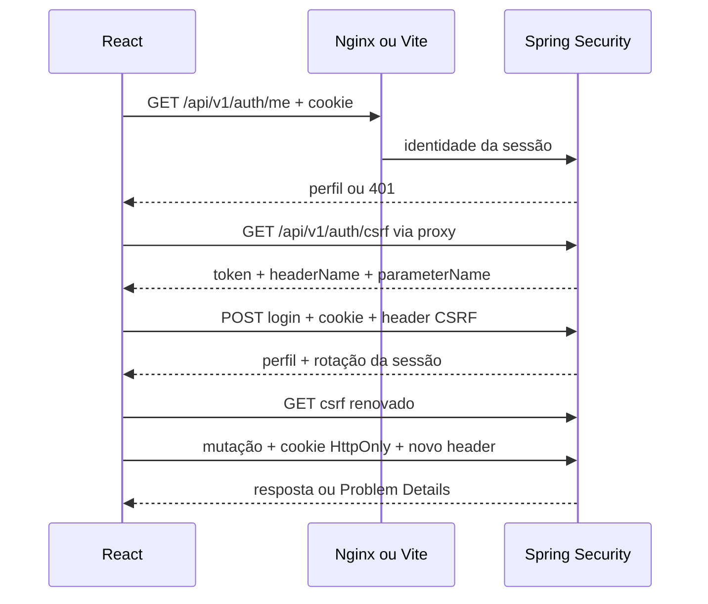
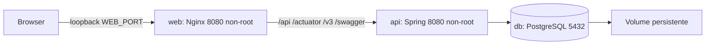

# Arquitetura Full Stack / Full-stack architecture

## Português

### Fronteiras e estado

`frontend/src/features` organiza auth, catálogo, carrinho, pedidos e administração. `app` compõe providers, guards e layout; `components/ui` contém estados, paginação, campos e dialog compartilhados; `types/api.ts` define schemas Zod e tipos inferidos; `lib/api.ts` é a única camada HTTP de produção. Não há camada de serviço Node nem cópia das entidades JPA no navegador.

TanStack Query mantém estado remoto: identidade, páginas, produtos, saldos e pedidos. Chaves distinguem consultas públicas e administrativas. As consultas usam AbortSignal, sem retry global; mutações não são repetidas. Após produto/status/estoque/pedido, invalidam-se as consultas relacionadas. Login preserva a consulta observada de identidade e remove as demais para impedir dados de outra conta. HTTP401 remove consultas privadas e publica identidade nula. Trocar apenas o cookie não é suficiente para atualizar a UI.

Context guarda carrinho e notificações. Apenas carrinho e tema persistem no localStorage. Não persistem cache de API, perfil, senha, sessão nem CSRF. Carrinho é local ao navegador, não pertence a uma conta no servidor e não reserva saldo. O payload do pedido descarta nome, SKU, preço e estimativas locais. Somas estimadas usam centavos inteiros; o backend continua a autoridade decimal e transacional. RHF mantém estado de formulário; Zod valida entradas e respostas, com backend como autoridade final.

### Rotas e erros

React Router usa `/`, `/produtos/:id`, `/entrar`, `/cadastro`, `/carrinho`, `/checkout`, `/pedidos`, `/pedidos/:id`, `/conta` e `/admin/**`. Checkout/pedidos/conta exigem identidade; admin exige papel. Guard aguarda restauração da sessão e distingue falha de rede de ausência de login. O destino pós-login aceita somente caminho local, bloqueando `//` e barras invertidas. Logout navega para a rota pública antes de remover identidade para evitar corrida com o guard.

O cliente HTTP envia `credentials: include`, `Accept`, JSON quando necessário e CSRF centralizado. Respostas são verificadas em runtime. Problem Details vira `ApiError` com status e dados; UI mostra mensagens humanas e não exibe SQL/stack trace. Falha crítica de mutação permanece em alert, além de notificações transitórias para sucesso. HTTP409 pede revisão do estado; carrinho permanece disponível. Falha de rede em compra tem resultado incerto: consultar pedidos antes de repetir. Não existe garantia de exactly-once sem idempotência no servidor.

### Autenticação e CSRF

O código usa uma promessa compartilhada para obtenção inicial do CSRF e mantém o token apenas em memória. Login renova; logout e 401/403 descartam o valor. Falha CSRF não reproduz automaticamente a mutação. O próximo envio obtém um token novo. Spring impõe CSRF inclusive a cadastro/login, RBAC em `/admin/**` e ownership em pedidos; esconder links nunca substitui essa verificação.

### Topologia e visual

API e banco não publicam portas no Compose. Nginx entrega assets imutáveis e fallback SPA, além de headers de segurança; index não fica em cache de longo prazo. Vite faz proxy `/api` no desenvolvimento. Ambos mantêm a experiência mesma origem para cookie/CSRF sem CORS amplo. O proxy HTTP local não é um ingress de produção HTTPS.

CSS próprio utiliza tokens claros/escuros, breakpoints, foco e reduced motion. A marca SVG e placeholders por SKU dispensam imagens externas. Native dialog fornece modalidade/foco/Escape; erro de campo usa `aria-describedby`. Consultas paginadas, cache e imports lazy limitam trabalho e bundle. O dashboard distingue total reportado pela API de contagens apenas entre registros carregados; estoque sem nome mostra o ID real, sem join fictício.

## English

React is organized by feature; shared app providers/guards/layout, UI states and a small central HTTP client support those features. Zod schemas infer types and validate runtime responses. Java remains the only backend.

TanStack Query owns remote identity/catalog/inventory/orders; context owns cart/notifications and RHF owns form state. Only a nonsensitive cart and theme persist. Identity and private cache are cleared on HTTP401/account changes. Login updates the existing observed identity query instead of removing it. Logout reaches a public route before clearing identity to avoid a guard race.

Routes distinguish public, authenticated and ADMIN experiences; local-only return paths prevent open redirects. Guards provide UX, while Spring owns CSRF, RBAC and order ownership. Credentials use the HttpOnly session cookie. CSRF uses the endpoint-provided header, stays in memory and is refreshed after login; 401/403/logout reset it. No mutation is replayed automatically. HTTP409 preserves the cart; ambiguous network outcomes require checking order history before retrying.

The diagrams above document authentication and deployment. Nginx serves the SPA and proxies the API on one origin; only web binds a host loopback port. API/PostgreSQL stay internal, with a persistent volume. Vite proxies `/api` for development. Node is build/test tooling. Local HTTP is not a production HTTPS ingress.

Custom CSS tokens support both themes, responsive grids/cards, focus and reduced motion. Native dialogs and associated validation errors provide accessibility foundations. Product artwork is deterministic, not a real image field. Paginated queries/cache/lazy routes keep complexity controlled. Dashboard metrics explicitly distinguish global totals returned by the API from counts in loaded pages. See ADRs [005](decisions/005-react-frontend.md) and [006](decisions/006-same-origin-proxy.md).
