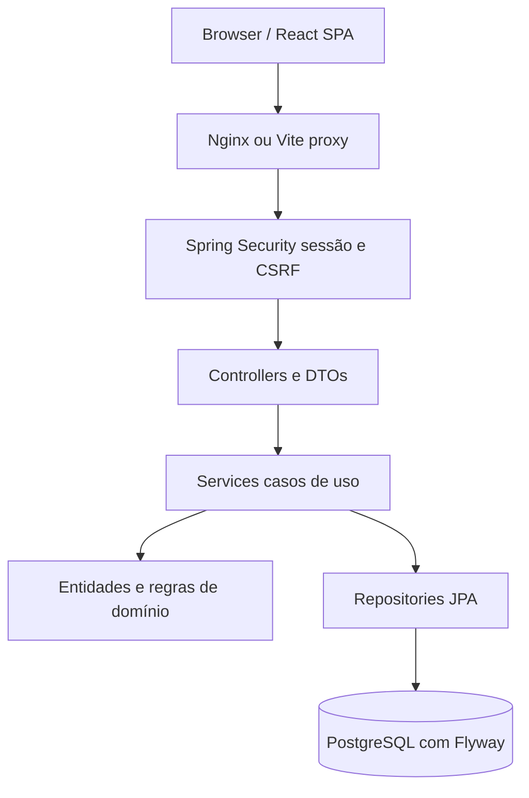
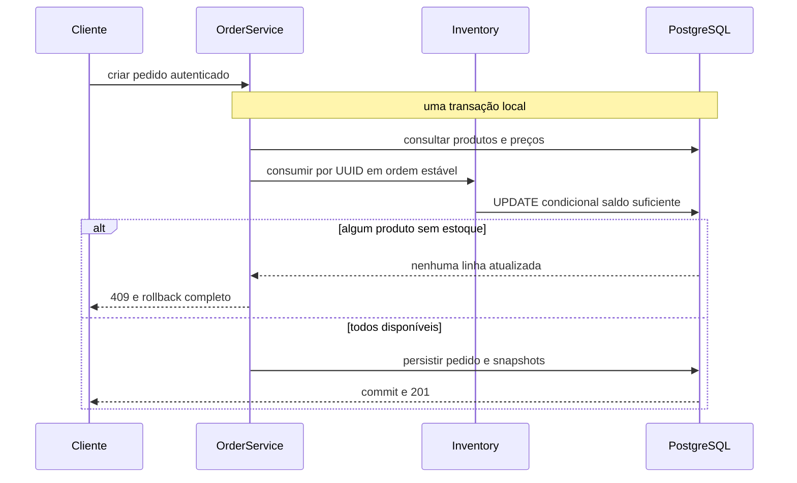

# Arquitetura / Architecture

## Português

### Compatibilidade de versões

Alvo Java 21; execução local verificada com JDK 25, sem alterar o Java global. Spring Boot 4.1.2 gerencia JUnit Jupiter 6.0.3. O prompt citava JUnit 5, mas forçar 5.14.4 causou `NoSuchMethodError` no `SpringExtension`; preservamos a combinação suportada pelo framework. Os testes continuam usando a API Jupiter (`@Test`, assertions e extensões), com execução real via Surefire/Failsafe. Referências: [requisitos do Boot](https://docs.spring.io/spring-boot/system-requirements.html) e [springdoc](https://springdoc.org/).

O OrderSphere é um monólito modular: um processo Spring Boot e um PostgreSQL. Os pacotes `auth`, `user`, `catalog`, `inventory`, `order` e `shared` agrupam responsabilidades por domínio. Não há filas, chamadas entre serviços ou transações distribuídas.

Controllers traduzem HTTP, validam a estrutura e delegam. Services coordenam transações. Entidades preservam regras e snapshots. Repositories executam consultas e atualizações persistentes. Constructor injection torna as dependências visíveis; não há interfaces `Impl` para cada classe.

| Domínio | Responsabilidade | Evidência |
| --- | --- | --- |
| Auth / User | Cadastro, senha com hash, login, sessão, identidade | [`auth`](../../src/main/java/com/ordersphere/auth), [`user`](../../src/main/java/com/ordersphere/user) |
| Catalog | SKU, preço, ativação e busca paginada | [`CatalogService`](../../src/main/java/com/ordersphere/catalog/CatalogService.java) |
| Inventory | Saldo não negativo e operações atômicas | [`inventory`](../../src/main/java/com/ordersphere/inventory) |
| Orders | Pedido do proprietário, snapshot e cancelamento | [`order`](../../src/main/java/com/ordersphere/order) |
| Shared | Configuração, erros e segurança HTTP | [`shared`](../../src/main/java/com/ordersphere/shared) |

### Modelo e limites transacionais

`app_users` identifica o proprietário de `orders`; `order_items` pertence ao pedido. `products` representa o catálogo e `inventory` mantém um saldo por produto. Itens guardam identificador, SKU, nome, preço unitário, quantidade e subtotal da compra. Não há exclusão física de produtos na API.

Criar pedido consome estoque e persiste itens na mesma transação. Cancelar bloqueia a linha do pedido, verifica o proprietário e devolve os itens uma única vez. A ordem estável de produtos reduz ciclos de lock. Timeouts e falhas de infraestrutura ainda podem abortar uma transação; o cliente deve tratar erros sem presumir sucesso.

### Decisões e evolução

1. [Monólito modular](decisions/001-modular-monolith.md).
2. [Concorrência de estoque](decisions/002-inventory-concurrency-strategy.md).
3. [Snapshot de preço](decisions/003-order-price-snapshot.md).
4. [Sessão e CSRF](decisions/004-authentication-strategy.md).

A v0.2.0 consome os contratos REST com React/TypeScript; veja [arquitetura full-stack](frontend.md), [ADR 005](decisions/005-react-frontend.md) e [ADR 006](decisions/006-same-origin-proxy.md). Extrações de módulos exigirão evidências de necessidade e uma nova estratégia de consistência; separação de pacotes não transforma automaticamente o sistema em microsserviços.

## English

### Version compatibility

The compilation target is Java 21; local verification used JDK 25 without changing Windows defaults. Spring Boot 4.1.2 manages JUnit Jupiter 6.0.3. Although the original brief requested JUnit 5, forcing 5.14.4 produced a `NoSuchMethodError` in Spring's `SpringExtension`. The project therefore retains the compatible framework-managed version and the Jupiter programming model. See the [Boot requirements](https://docs.spring.io/spring-boot/system-requirements.html) and [springdoc compatibility documentation](https://springdoc.org/).

OrderSphere is a modular monolith: one Spring Boot process and one PostgreSQL database. Packages `auth`, `user`, `catalog`, `inventory`, `order` and `shared` group cohesive responsibilities by domain. Controllers handle HTTP and DTO validation; services coordinate use cases and transactions; entities preserve business rules; repositories handle persistence.

The diagrams above show the request path and the order transaction. `app_users` owns `orders`; `order_items` stores purchase snapshots. `products` holds the current catalog and `inventory` holds one balance per product. Products are deactivated rather than deleted through the API.

Creating an order consumes inventory and persists snapshots in one transaction. A failed item rolls back the entire purchase. Products are processed in stable UUID order to reduce lock cycles. Cancellation locks the order row, enforces ownership and restores inventory once. Database timeouts and infrastructure failures can still abort a transaction.

The linked ADRs record deployment, concurrency, snapshots and sessions. React now consumes the existing REST API; see [frontend architecture](frontend.md) and ADRs005/006. Splitting backend processes would still require a new consistency design and evidence that the operational cost is justified.
